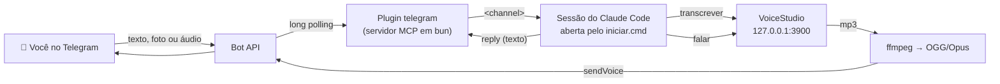

<div align="center">

# specialized-assistant

**Converse com o Claude Code pelo Telegram, por texto ou por voz, com transcrição e fala rodando na sua máquina.**


</div>

---

Você manda um áudio no Telegram. O Claude Code transcreve, trabalha no seu computador e
responde duas vezes: um texto completo, com código, links e caminhos, e um áudio curto com o
essencial. Mensagem em texto recebe só texto. A voz e a transcrição rodam localmente no [VoiceStudio](#voicestudio): nenhum
áudio sai da máquina, e não há chave de API de voz para pagar.

## Como funciona



1. O plugin oficial `telegram@claude-plugins-official` recebe a mensagem e a entrega à sessão.
2. Se for áudio, a sessão baixa o arquivo e chama `telegram_voz.py transcrever`, que manda o
   áudio ao Whisper do VoiceStudio.
3. A resposta sai em texto pela ferramenta `reply` e, se a mensagem veio em áudio, logo depois em áudio por
   `telegram_voz.py falar`: o VoiceStudio sintetiza em mp3, o ffmpeg converte para
   OGG/Opus, e o script envia como mensagem de voz nativa.

As regras de comportamento (texto sempre e áudio só para áudio, texto curto e em MarkdownV2, áudio curto e sem markdown, avisar antes
de trabalho longo e editar essa mesma mensagem com o andamento) ficam em [`channel/instrucoes-voz.md`](channel/instrucoes-voz.md) e
entram na sessão por `--append-system-prompt-file`.

## O que tem aqui

| Arquivo | Vai para | Papel |
|---|---|---|
| [`channel/iniciar.cmd`](channel/iniciar.cmd) | `%USERPROFILE%\.claude\channels\telegram\` | Abre a sessão com o canal, o plugin e as instruções de voz |
| [`channel/settings-sessao.json`](channel/settings-sessao.json) | idem | Só nesta sessão: liga o plugin, os hooks do "digitando" e a permissão do `claude_sessoes.py` |
| [`channel/reiniciar.cmd`](channel/reiniciar.cmd) | idem | Zera a sessão: encerra, reabre pelo `iniciar.cmd` e avisa no Telegram |
| [`channel/instrucoes-voz.md`](channel/instrucoes-voz.md) | idem | Regras da sessão: como receber e responder em voz |
| [`channel/.env.example`](channel/.env.example) | idem, como `.env` | Modelo do arquivo do token do bot |
| [`channel/access.example.json`](channel/access.example.json) | idem, como `access.json` | Começa em pareamento e reage com 👀 ao receber |
| [`scripts/telegram_voz.py`](scripts/telegram_voz.py) | `%USERPROFILE%\.claude\scripts\` | Transcreve, sintetiza e envia voz, mantém o "digitando" e zera a sessão; só biblioteca padrão |
| [`scripts/claude_sessoes.py`](scripts/claude_sessoes.py) | idem | Abre e conduz sessões novas do Claude em segundo plano |
| [`docs/setup-windows.md`](docs/setup-windows.md) | | Instalação passo a passo e problemas conhecidos |
| [`docs/originais/`](docs/originais/) | | Guia genérico em inglês que serviu de ponto de partida |

## Instalação rápida

Pré-requisitos: [Claude Code](https://docs.claude.com/en/docs/claude-code), bun, ffmpeg,
Python 3.10+ e o VoiceStudio. Os detalhes de cada passo estão em
[`docs/setup-windows.md`](docs/setup-windows.md). No CMD, de dentro do clone:

```cmd
mkdir "%USERPROFILE%\.claude\channels\telegram" "%USERPROFILE%\.claude\scripts"
copy channel\iniciar.cmd channel\reiniciar.cmd channel\settings-sessao.json channel\instrucoes-voz.md "%USERPROFILE%\.claude\channels\telegram\"
copy channel\access.example.json "%USERPROFILE%\.claude\channels\telegram\access.json"
copy scripts\telegram_voz.py scripts\claude_sessoes.py "%USERPROFILE%\.claude\scripts\"
python -I "%USERPROFILE%\.claude\scripts\telegram_voz.py" --demo
python -I "%USERPROFILE%\.claude\scripts\claude_sessoes.py" --demo
```

Para que cada `git pull` valha na hora, ligue a pasta dos scripts ao clone em vez de copiá-los: sem a
pasta `scripts` no `mkdir` e sem o `copy` dela, rode `mklink /J "%USERPROFILE%\.claude\scripts" "%CD%\scripts"`.
A junção dispensa administrador, ao contrário do link simbólico de arquivo.

Depois:

1. **Plugin**: numa sessão do Claude Code, `/plugin install telegram@claude-plugins-official`.
   No `settings.json` global, deixe-o `false`; quem liga é o `iniciar.cmd`.
2. **Token**: crie o bot no @BotFather e grave o `.env` **sem CRLF**:
   ```cmd
   <nul set /p "=TELEGRAM_BOT_TOKEN=<seu token>" > "%USERPROFILE%\.claude\channels\telegram\.env"
   ```
3. **Pasta de trabalho**: edite `PASTA_DE_TRABALHO` no `iniciar.cmd`.
4. **VoiceStudio**: instale em `%LOCALAPPDATA%\Programs\VoiceStudio`. Com o app fechado, o script o abre e
   espera a API responder em `http://127.0.0.1:3900` (cerca de 3 min, teto de 6).
5. **Rode** `iniciar.cmd`, mande uma DM ao bot e pareie com `/telegram:access pair <codigo>`.
   Tranque com `/telegram:access policy allowlist`.
6. **Menu**: rode `telegram_voz.py menu` uma vez para pôr `/zerar`, `/sessoes` e `/saude` no botão de menu do bot. O
   plugin regrava o menu dele a cada subida, mas só no escopo geral; o do seu chat tem prioridade e fica.

## O script de voz

```text
telegram_voz.py transcrever <arquivo>        imprime o texto do áudio; recusa áudio mudo (pico até -60 dB)
telegram_voz.py falar <chat_id> [reply_to]   lê o texto do stdin e manda como mensagem de voz
telegram_voz.py amostra <arquivo.ogg>        lê o texto do stdin e grava o áudio, sem Telegram
telegram_voz.py vozes                        lista as vozes do VoiceStudio
telegram_voz.py voz <voice_id> [modelo]      escolhe a voz
telegram_voz.py modo <chat_id> [texto|audio] lê ou troca o modo de resposta do chat
telegram_voz.py digitando [parar]            hook: mantém o "digitando" ligado enquanto a sessão trabalha
telegram_voz.py reiniciar                    zera a sessão do Telegram depois do turno atual
telegram_voz.py saude                        bot, VoiceStudio e sessões em segundo plano, sem mexer em nada
telegram_voz.py perguntar <chat_id> <opção>… pergunta pelo stdin, um botão por opção (a primeira sai azul)
telegram_voz.py menu                         registra /zerar, /sessoes e /saude no menu do bot, no escopo do seu chat
telegram_voz.py --demo                       auto-check, sem rede
```

| Variável | Padrão | Para quê |
|---|---|---|
| `VOICESTUDIO_URL` | `http://127.0.0.1:3900` | Onde está a API do VoiceStudio |
| `TELEGRAM_VOZ_IDIOMA` | `pt` | Idioma da transcrição e da fala |
| `TELEGRAM_STATE_DIR` | `%USERPROFILE%\.claude\channels\telegram` | Pasta do canal, a mesma variável que o plugin usa |
| `TELEGRAM_BOT_TOKEN` | lido do `.env` | Token do bot; o script nunca o imprime |

## Além da voz

| Função | Como pedir no Telegram | Como funciona |
|---|---|---|
| **Sessões novas** | "abre uma sessão nova e..." | `claude_sessoes.py nova` abre outra sessão do Claude com `claude --bg`, sem o contexto da conversa do Telegram. Dá para abrir várias, cada uma com o próprio id |
| **Sessões do app Desktop** | "manda para a sessão X..." | A sessão do Telegram entrega a mensagem pela ferramenta `SendMessage`, direto na sessão aberta no app, sem cópia |
| **Aviso de fim** | Chega sozinho | Cada sessão aberta pelo `nova` leva um hook `Stop` que manda ao Telegram o nome, o id e a última resposta num bloco recolhível, com até 3000 caracteres: o Telegram mostra 3 linhas e abre o resto no toque |
| **"Digitando" contínuo** | Aparece sozinho | O plugin manda `typing` uma vez, e o Telegram o apaga em cerca de 5 s; os hooks da sessão o renovam a cada 4 s até o turno acabar |
| **Rascunho ao vivo** | Aparece sozinho | A cada ferramenta, um rascunho no chat diz o que a sessão está fazendo ("Lendo telegram_voz.py", ou a descrição do comando, nunca o comando). Ele some quando a resposta chega |
| **Perguntas com botões** | Aparece sozinho | Pergunta fechada sai pelo `telegram_voz.py perguntar`, com um botão por opção; o toque volta como texto comum |
| **"Gravando áudio"** | Aparece sozinho | Durante a síntese da voz, o indicador vira `record_voice` |
| **Saúde** | `/saude` | `telegram_voz.py saude` diz se o bot e o VoiceStudio estão no ar, quantas sessões do Telegram estão abertas e quais sessões em segundo plano esperam por você |
| **Arquivos** | "me manda o PDF" | A sessão anexa o arquivo pelo `files` do `reply`: imagem chega como foto, o resto como documento, até 50 MB |
| **Zerar a conversa** | "zera você" ou `/zerar` | `telegram_voz.py reiniciar` espera o turno acabar, fecha a sessão, reabre pelo `iniciar.cmd`, e o bot avisa que voltou |

```text
claude_sessoes.py nova <nome> <pasta>   prompt pelo stdin; abre a sessão em segundo plano
claude_sessoes.py enviar <id>           mensagem pelo stdin; continua a mesma sessão, sem cópia. Recusa se ela
                                        estiver trabalhando ou aberta no app Desktop, e para a cópia se o Claude abrir uma
claude_sessoes.py ler <id>              estado e última resposta, lidos do transcript
claude_sessoes.py listar                sessões em segundo plano e o estado de cada uma
claude_sessoes.py parar <id>            encerra; a conversa fica salva
claude_sessoes.py --demo                auto-check, sem rede
```

No PC, qualquer sessão aberta assim abre no terminal com `claude attach <id>`.

## VoiceStudio

App desktop que expõe, em `127.0.0.1:3900`, uma API compatível com a da OpenAI
(`/v1/audio/transcriptions` e `/v1/audio/speech`). Só responde com o app aberto, e o motor leva cerca de 3 min para subir. Testado na
versão 0.5.7, com o Whisper large-v3 Turbo na transcrição.

> [!WARNING]
> A voz OmniVoice é licenciada CC-BY-NC, só para uso não comercial. Confira a licença do
> modelo de voz que você escolher.

> [!TIP]
> Se o app mostrar **"Não foi possível iniciar o motor local. spawn UNKNOWN"**, o Windows
> está barrando o `python.exe` do `.venv` dele. O conserto está em
> [`docs/setup-windows.md`](docs/setup-windows.md#não-foi-possível-iniciar-o-motor-local-spawn-unknown).

## Segurança

- O token do bot vive só no `.env`, que está no `.gitignore` junto com `access.json`,
  `inbox\`, `state\` e `bot.pid`.
- O plugin recusa anexar qualquer arquivo da pasta do canal, exceto o que está em `inbox\`:
  o `.env` não sai pelo bot.
- Com a política `allowlist`, quem não foi pareado é ignorado em silêncio, e o pareamento só
  se aprova pelo terminal, nunca por mensagem do próprio Telegram.
- O `iniciar.cmd` abre a sessão em `--permission-mode auto`. Ajuste ao nível de autonomia que
  você quer dar a quem fala com o bot.

## Limites

- O bot só responde enquanto a sessão está aberta, e só vê o que chega com ela aberta.
- Um token, uma sessão: o Telegram aceita um único consumidor de `getUpdates` por bot.
- Só o Windows foi testado. O lançador é CMD.
